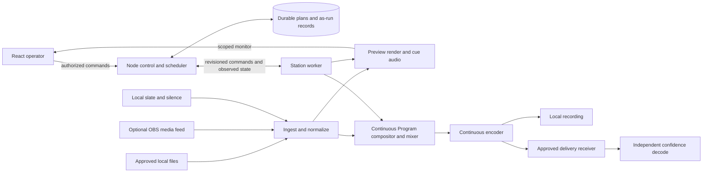

# PALLCOM MCR · Independent Program

**Phase 1 audit and implementation specification · 24 November 2026 · baseline `2c5eacc`.** This is the independent-Program initiative's audit phase. The existing repository roadmap uses separate phase numbers. Its station liveness and credential rotation work can be reused. Its MFA/recovery and audit milestone P0-003, worker lifecycle P1-001 and media validation P1-002 are still open. Use local fixtures during development and satisfy the worker security gates before network-facing rollout. [Task register](TASKS.md) · [Existing architecture decision](decisions/0001-control-media-boundary.md)

## Today's signal path

| Input or action | Preview, composition and audio | Where the signal goes |
|---|---|---|
| Station live input | An operator configures a source and its scene in OBS. The guide names RTMP and NDI feeds received there. Capture devices, desktop, microphones and other installed OBS sources enter through the same station-defined scene/input model. The API enumerates scene items and inputs. Their actual device inventory, plugin support, transforms and routing reside on the station. | OBS composites visible items, mixes enabled audio and renders its current Program. A scheduled live block selects a scene by name. |
| Local clips, commercial spots and fallback playlist | Agent scans permitted roots, resolves asset IDs and probes metadata with ffprobe. Cue selects an inactive dedicated A/B deck, checks its Media Source, and assigns the file. Take restarts playback, checks status/cursor, cuts to the deck and confirms the Program scene. Embedded audio follows the OBS input mix. | Same OBS Program. The server tracks the active item, fixed starts, filler and backup scene in SQLite. Its backup requires a functioning OBS compositor. |
| Graphics and ads | One path updates named OBS text inputs and scene-item visibility. Another serves a station-token React overlay with logo, ad artwork/text and ticker. An OBS Browser Source fetches it, polls about every two seconds and renders it above the video. Current graphic expiry uses server remaining time and browser timers. Operator audition/alert audio is local to the dashboard. | The Browser Source must be in the active composition for its pixels to air. The overlay route alone supplies graphics, without the underlying picture or mix. |
| Preview and monitoring | Live Control changes OBS Studio Mode/Preview. ProgramPreview requests the selected scene's 480 px JPEG and polls again three seconds after completion. Preview requires Studio Mode. Multiview arranges these images. Telemetry supplies OBS status, peaks and stream counters. | Operator browser gets snapshots and data. There is no continuous confidence return with synchronized audio here. |
| Final delivery | Current Program scene, transition and audio levels feed OBS output. Stream/record commands ask OBS to start or stop and query its status. Replay controls operate its configured buffer. | The actual destinations are the stream service/server in the station's OBS profile, its local recording target and saved replay files. The repository does not identify the configured stream protocol, endpoint, recording format or path. There is no independently configured MCR publisher, HLS origin or Program download route. |

The RTMP/NDI examples document **inputs**. HTTPS serves UI/API/overlay images, Socket.IO serves scoped dashboard updates, outbound WSS carries station commands/events and local WebSocket v5 controls OBS (default port 4455). None establishes an MCR media delivery protocol. [Playout guide](../backend/docs/PLAYOUT_GUIDE.md) · [Signal adapter](../backend/packages/obs-client/src/index.js) · [Preview component](../frontend/src/components/ProgramPreview.jsx) · [Graphics renderer](../frontend/src/components/BroadcastOverlay.jsx)

### OBS dependency register

| Runtime boundary | Dependency and failure behavior |
|---|---|
| Station setup, pairing and startup | The Windows launcher/CLI starts the station Agent. Pairing and the local keystore supply station connection details. The daemon instantiates the OBS adapter and forwards events. Agent connection and fresh OBS telemetry are separate readiness signals. [Agent entry](../backend/agent/src/index.js) · [Gateway](../backend/src/infrastructure/agent/agent-gateway.js) |
| RPC dispatch | Express resolves tenant/station and sends a correlated command through the Agent gateway. In the Agent dispatcher only scan/check media bypass the connected-OBS guard. Snapshot, version, stats, scene list, screenshot and all OBS mutations require the adapter. [Controllers](../backend/src/presentation/controllers/obs.controller.js) · [Command dispatch](../backend/agent/src/server-tunnel.js) |
| Scene and mix | Snapshot reads scenes/items, input levels/mutes, Studio Mode, transitions and output states. Program/Preview select, cut, transition trigger/type/duration, T-bar, visibility, text and audio gain/mute all call OBS v5. Shared input mutations can affect an on-air scene even while another scene is cued. [OBS calls and event subscriptions](../backend/packages/obs-client/src/index.js) |
| Playout, macros and jobs | Server playout uses Agent cue/take/status/graphics commands, media-ended and manual-scene events. Loss of readiness gates the timer and new takes. Reconnect reconciles the last Program. Separately, a one-second server job poller claims scheduled scene/record actions. Immediate macros use the same OBS commands. Both paths must select the station's output owner in a migration. [Engine](../backend/src/infrastructure/playout/engine.js) · [Automations](../backend/src/presentation/controllers/automation.controller.js) |
| Monitoring and outputs | Stream/record status and confirmations, bitrate deltas, replay start/stop/save and last-save event, per-input peaks and scene JPEGs originate in OBS. Agent metrics, a successful command and an increasing byte counter each describe a different observation. Receiver decode is required to establish delivered content. [Telemetry](../backend/agent/src/telemetry.js) · [Adapter](../backend/packages/obs-client/src/index.js) |

## Deployment evidence and choices

The checked-in Render Blueprint defines one free Node 22 web service hosting React, Express and the Agent tunnel, with SQLite under /tmp. Compose alternatively defines Node and TLS Nginx with a named SQLite volume. Neither manifest provisions a mixer, encoder, receiver or worker. The station guide describes a separately launched Windows Agent alongside OBS. On the audited Windows workstation, PATH lookup and version probes found Node 24.15.0 and FFmpeg/ffprobe 8.1.2. Docker, gst-launch-1.0 and obs64 were absent from PATH. A process-name snapshot found no OBS, FFmpeg, ffprobe, GStreamer launcher or MediaMTX process. Installed tools on this machine do not establish deployment capacity. The live deployment, OBS profile, hardware and account plan are unverified. [Blueprint](../render.yaml) · [Compose](../backend/infrastructure/docker/docker-compose.yml) · [Operations guide](../README.md)

| Architecture | Hosting and latency | Recovery and operating cost |
|---|---|---|
| Operator browser compositor | Accessible to the current UI, has local preview, depends on tab lifetime and browser capture/codec permissions | Closing the tab removes the producer. Unsuitable for unattended playout. |
| Media subprocess in the existing web service | Shares CPU/network and process lifecycle with Express. Free Render can sleep after idle traffic and lose local files. | API deploy/restart interrupts output and can erase the schedule. Simple to launch, poor isolation. [Render free-service constraints](https://render.com/docs/free) |
| Supervised worker on an always-on station or dedicated host **(recommended)** | Near files and optional OBS feed. Keep per-source decoders warm, use bounded queues and a continuous compositor/mixer/encoder. Local placement avoids a WAN round trip in the media path. | Requires service supervision, durable state and measured capacity. Control UI can disconnect. A worker crash still causes an outage until recovery. |
| Dedicated hosted worker | Requires persistent compute/storage, approved ingress/egress and upload capacity at each station. Adds network buffering for local signals. | Isolates station failures when sources and fallback are available in hosting. Adds network operations, credentials and recurring compute costs. |

Start with one durable Compose control host and one isolated media worker on the same host, or under equivalent service supervision on an approved station. Use a persistent GStreamer pipeline for dynamic source selection, audio mixing, overlays and encoder fan-out. Use FFmpeg/ffprobe independently to generate fixtures and inspect the result. Prototype caps, plugin availability, CPU and licensing before packaging. Restarting a per-scene FFmpeg command would also restart encoder state and complicate seamless takes. React and Node remain the operator and control layers. [GStreamer compositor](https://gstreamer.freedesktop.org/documentation/compositor/index.html)

## Proposed architecture

The API clock and worker run as services with persistent storage and restart policies. On browser close, the worker keeps rendering, the encoder and sinks remain attached, and the scheduler can issue future takes. With the control service unavailable the worker holds its current live source, advances precommitted timed items from a durable bounded schedule horizon, then uses local fallback. Reconnect reconciles the observed generation and last applied event before accepting new work. Render free alone cannot guarantee this service lifetime or durable scheduling.

### Contracts to implement

All commands carry station and organization scope, an operation ID and expected revision. The API derives scope from the authenticated principal, checks station ownership and capability on each read, configuration write and live action, and revalidates scheduled authority before dispatch. Bound offline execution to a short-lived, preauthorized horizon with expiry. A supervised worker accepts typed commands from its authenticated controller only. Persist operation result, principal, scope and revisions for idempotency and audit. Expose source IDs, sanitized status and short-lived read-only monitor access. Keep destination credentials and privileged media operations on trusted services.

| Contract | Request and result | Invariant or failure behavior |
|---|---|---|
| Input ingestion | Register a typed source with opaque asset/endpoint reference, allowed profile and fallback source ID. Worker emits readiness, last good audio/video PTS, signal age, format and failure reason. | Decode to a fixed canvas/rate and audio format. Bound decoder queues and resources. Check media freshness independently of OBS control heartbeat. After 1 s missing required media, substitute configured source, then local slate/silence if unavailable. Reject fallback cycles. Default to manual return after 5 s healthy. |
| Scene state | Save immutable, versioned scene snapshots with ordered source layers, crop/position, graphics, audio routes/gain/mute and fallback references. Validate source scope and availability policy. | Updating an asset/scene creates a revision. Program references its committed revision until an explicit live action. Pin assets for the lifetime of active snapshots. |
| Operator Preview | Cue a scene revision on the station Preview bus with independent file cursors, cue mixer and monitor endpoint. Return observed revision, frame time and readiness. | Use one shared station Preview and optimistic revision checks across operators. Cue/seek/solo/graphics editing cannot mutate live cursors or audio. Slow or absent viewers may drop monitor frames. |
| Program composition | Start on slate, take a ready Preview revision or explicit approved scene with transition, expected Program revision and effective frame. Report accepted, then applied with generation, revision and first output PTS. | Serialize takes from manual, macro and schedule paths. Reject stale takes and deduplicate retries. Stage layers/audio atomically at the frame boundary. Default file take starts at the cued in-point. Preview remains on its cued revision. Explicit live gain/graphics commands create audited Program revisions. Fallback replaces only the failed input's picture/audio in each affected layer. |
| Output delivery | Bind an approved destination ID/profile to Program, start/stop recording or publishing independently, report encoder state, sink state, bytes/time and receiver observations when available. | Keep encoder clock running across scene changes and OBS loss. Isolate slow or failed sinks with bounded queues/reconnect. An active encoder alone cannot mark a destination verified. First sink is a local recording plus loopback MPEG-TS receiver. External publish requires a separately approved adapter and profile. |

### Timing rules

* **Schedule by instant.** Accept an IANA station timezone and civil time, require an explicit offset for an ambiguous DST time, reject skipped local times, and persist resolved UTC epoch milliseconds plus the original zone. Retain existing absolute hard starts. Compare against a synchronized host UTC clock, wake with monotonic timers, and recompute deadlines after clock adjustments. A unique occurrence ID and durable claim prevent a second take after a backward step or restart. A manual emergency cut wins over a simultaneous scheduled take and suspends automation until released.
* **Play by media time.** Default staging profile is 1280×720 at 25 fps, stereo 48 kHz. Use integer presentation ticks at 90 kHz (3,600 per frame) and integer audio sample counts. Map source rational timestamps to the worker's monotonic running time, maintaining continuous output PTS across switches and input reconnects. Use end-exclusive in/out points. Show milliseconds in the existing UI. Measure a clip or graphic ad from its first committed Program frame to its exclusive end, rounding presentation boundaries to the next frame. Preview, wall-clock correction and UI timers cannot consume its duration.
* **Reconcile.** Log planned UTC, applied UTC, first/last Program PTS, occurrence and actual end reason. Pre-cue a hard start, preempt a lower-priority item at its due frame. After restart skip an elapsed window and log it. For a still-open fixed window, seek seekable media to its elapsed offset or join a live input, using the remaining window. On worker restart begin a new output generation, record the discontinuity, acquire a single-owner lease and recover to slate before resuming eligible content.

### External URLs

| Input offered to an operator | Program eligibility | Security and operating policy |
|---|---|---|
| Direct media stream or manifest | A worker can demux an explicitly supported protocol/codec and supply decoded A/V. First network fixture is an administrator-provisioned loopback feed. Later qualify a specific HTTPS media profile per receiver. | Accept registered endpoint IDs. Enforce approved scheme/host/port and resolved addresses at connect, redirect and manifest/segment/key requests. Deny unintended local, private and metadata access with network isolation, restrict nested protocols and cap bytes, redirects, time and decoder resources. Inject scoped credentials server-side. |
| Supported provider embed | An approved provider player may be shown as a labeled operator reference. Program requires a provider-authorized direct feed or a separately qualified isolated capture adapter with both picture and audio. An iframe URL alone supplies neither to the mixer. | Require provider-specific rights, authentication, embedding/capture permission and fixtures. Respect DRM and provider restrictions. Keep operator cookies and session tokens out of capture. |
| Arbitrary web page | Exclude from initial Program inputs. Rendering a page would require a dedicated browser renderer, A/V capture, timeout and fallback. The existing first-party graphics route is narrowly scoped. | Untrusted script, navigation, subresources, private-network access, resource exhaustion and variable autoplay make general capture a separate security boundary. If later approved, isolate browser process, identity, storage, egress and device access per source. |

## Ordered delivery and open decisions

1. Preserve existing stations on the OBS adapter. Inventory deployed hosts, sample files, schedules, source mappings, role checks and the station's delivery profile with its owner. Record identifiers and settings with secrets redacted. Establish disposable SQLite, assets and a loopback-only receiver.
2. Deliver the worker registry, enrollment/revocation, typed command and result schemas, station fencing, durable revisions, idempotency and supervision. Add explicit station output ownership. Route existing scene, automation and recording workflows by owner. Disable unsupported actions clearly in independent mode.
3. Prove a local file and generated slate with tone through the persistent worker to a recording and receiver. Verify decode and clocks before introducing network sources. Add independent Preview and Program, audio and graphics; implement cut first, then qualify additional transitions.
4. Connect schedule and ad timing to worker acknowledgements, persist as-run evidence and test concurrent operators, restart and tab closure. Add optional OBS as an explicitly provisioned media sender, monitor media health, exercise fallback and controlled return.
5. Qualify a staging delivery adapter, reconnects, capacity and recovery. Enable independent output per station after acceptance. For rollback stop/fence its publisher, confirm destination release, then explicitly return ownership to the legacy OBS path with an available OBS station. Never let both owners publish to the same target.

| Missing decision or evidence | Recommended default | Work that can proceed |
|---|---|---|
| Actual service URL/revision, hosting plan, durable mount, station uptime, CPU/GPU and operator-approved maintenance window | Compare authorized deployment inventory and /health revision/persistence; assume only local capacity until measured | Offline worker and control contracts, local fixture profiling |
| Destination owner, protocol, codec, resolution, rate, audio layout, latency budget and access to a staging receiver | Start with single local H.264/AAC 720p25 MPEG-TS sink and recording; keep production settings untouched | Measure local latency, A/V sync and failover |
| OBS host/network reachability, installed output plugins and dedicated contribution path | Qualify one private stream to a station-local receiver using an approved OBS profile; reserve the MCR's final destination exclusively for the worker | Exercise the same adapter using synthetic media |
| Station timezone, ad interruption policy, fallback artwork/audio and automatic return policy | Require zone selection, log interrupted ads, use slate/silence and manual return | Implement deterministic clock and failure tests |
| Provider entitlements, approved feeds, number of stations/inputs and availability target | Direct registered sources only, one worker/one station, restart recovery | Gate provider capture, scale-out and production SLA separately |

## Acceptance matrix

Use synthetic clips A/B with distinct burned-in frame counts and distinguishable tones, a timed graphic ad and a persistent local fallback. Capture receiver-side packets and decode A/V independently. Retain run ID, profile, worker generation, UTC/PTS, decoded frames/audio and as-run rows. Thresholds below are proposed staging gates.

| Gate | Procedure and pass condition | Evidence and current status |
|---|---|---|
| Baseline | Run the existing playout and bitrate suites with their simulated transport/counters. Timeline, fixed-start edit, filler/manual release and bitrate reset tests pass. | Automated, **4 passed** via `node --test backend/test/playout.test.js backend/packages/obs-client/test/stream-output.test.js`. |
| Cold start and tab independence | With OBS closed start independent mode, cue B, start recording and queue a take. Close all operator tabs for 10 min. Receiver continuously decodes Program, including the scheduled B picture and tone. | Receiver capture plus operator observation, pending |
| Bus isolation and concurrency | During A, edit B geometry, mute and scrub B in Preview. A picture/tone continue. Race two takes against the same revision, retry the winner. One commit, first matching B frame and audio at take, no stale edit applied. | API concurrency tests plus decoded frames/audio, pending |
| Time and ads | Test DST gap/fold, clock steps and duplicate occurrence delivery. Air a 10 s clip/ad at 25 fps, change wall clock mid-item. Visible duration is 250 frames within one frame; pre-cued fixed start within 100 ms of target on the synchronized staging host. | Automated fake-clock tests and receiver frame count versus UTC reference, pending |
| Loss and recovery | Air optional OBS in one layer beside an independent moving source and separate tone. Stop OBS, repeat with control connected but media stalled, then reconnect. Fallback appears within 1.2 s. Other layer/audio continue, no encoder restart, receiver video PTS gaps ≤80 ms, return only on configured policy. | Actual staging OBS, receiver recording, packet timestamps and as-run event, pending |
| Sink isolation and worker restart | Stop a local receiver while recording continues, reconnect and decode again. Kill only the disposable worker, check single owner and recovery to slate within 10 s, account for discontinuity and reconcile schedule once. | Captures, process generation, leases and audit, pending |
| Permissions and URL scope | Exercise viewer, authorized operator, admin and wrong-tenant IDs on read/configure/take/publish, including scheduled actions after revocation. Denied changes produce no worker command. Reject unapproved URLs and nested locations with a controlled local HTTP fixture. | Isolated API/worker tests, sanitized logs and client payload inspection, pending |
| Format, confidence and latency | Probe recording and loopback decode for agreed codecs, dimensions, cadence and sample rate; watch slate→A→B and listen for matching tones. Target A/V offset ≤40 ms and local take-to-visible p95 ≤500 ms over 30 cuts. | Automated probe plus separately recorded human observation at receiver, pending |

Audit acceptance covers repository tracing, local tool/process inventory and the four baseline tests above. No production endpoint or station was exercised. Actual independent Program, live deployment identity and receiver performance await the listed dependencies and later implementation.
