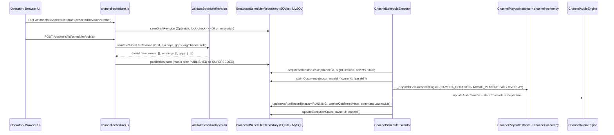

# Broadcast Scheduler Architecture (Phase Seven)

## 1. Architectural Purpose & Scope

Phase Seven implements the server-side multi-channel broadcast scheduling and multi-track timeline execution engine for **pallcom MCR**. The scheduler operates directly on top of the Phase Six per-channel GStreamer playout engine (`ChannelPlayoutInstance` in `backend/src/infrastructure/playout/channel-playout-supervisor.js`) and the Phase Five independent audio mixer (`ChannelAudioEngine` in `backend/src/infrastructure/audio/audio-mixer-engine.js`).

In accordance with repository boundary rules (`AGENTS.md`), the broadcast scheduler does **not** send raw commands to live OBS stations; OBS remains isolated behind the station Agent boundary.

---

## 2. Core Components

| Component | Path | Responsibility |
|---|---|---|
| **Scheduler Engine, Timezone/DST Resolver, Validator & Executor** | `backend/src/infrastructure/scheduler/broadcast-scheduler-engine.js` | Deterministic IANA civil-time-to-UTC conversion (`resolveLocalCivilTimeToUtcMs`), bounded recurrence expansion (`expandScheduleOccurrences`), server-side multi-track conflict & gap validation (`validateScheduleRevision`), lease-fenced per-channel execution (`ChannelScheduleExecutor`), and EPG program guide generation (`generateChannelEpgGuide`). |
| **Playout Supervisor Override Integration** | `backend/src/infrastructure/playout/channel-playout-supervisor.js` | End-to-end live source switching (`_activateSpecificSource`, `triggerManualSourceOverride`, `triggerEmergencySwitch`) across live camera slots (`live1`/`live2`), prerecorded media files (`play_file`), and fallback slate (`fallback:slate` / `emergency:slate`), plus continuous `48 kHz` stereo S16LE external audio pumping into `channel-worker.py`. |
| **Audio Mixer Crossfade Integration** | `backend/src/infrastructure/audio/audio-mixer-engine.js` | Real-time equal-power `sin`/`cos` crossfade (`startCrossfade`) during scheduled `INDEPENDENT_AUDIO` deck switches and automatic `FALLBACK_AUDIO` activation on primary signal loss. |
| **SQLite Scheduler Repository** | `backend/src/infrastructure/repositories/sqlite-broadcast-scheduler-repository.js` | Transactional SQLite persistence (`BEGIN IMMEDIATE`) for schedule revisions, lease acquisition (`acquireSchedulerLease`), write-ahead occurrence claiming (`claimOccurrence`), fenced execution state (`updateExecutionState`), and As-Run logs. |
| **MySQL / MariaDB Prisma Repository** | `backend/src/infrastructure/repositories/prisma-repositories.js` (`PrismaBroadcastSchedulerRepository`) | Prisma `$transaction` implementation of all `IBroadcastSchedulerRepository` contracts, including atomic CAS lease acquisition, write-ahead occurrence claims, and `SCHEDULED_PLAYBACK` deletion protection on `MediaAsset`. |
| **REST API Router** | `backend/src/presentation/routes/channel-scheduler.js` | Authenticated, RBAC-enforced endpoints under `/api/v1/channels/:channelId/scheduler*`. |
| **Multi-Track React Timeline UI** | `frontend/src/components/playout/MultiTrackBroadcastScheduler.jsx` | 7-track broadcast timeline editor with 24h time ruler, live playhead, Day/Week views, drag-and-drop palette, time-grid snapping, multi-select, copy/paste, undo/redo, manual/emergency override controls, As-Run viewer/CSV export, and revision history. |

---

## 3. Data Flow & Runtime Execution Loop

---

## 4. Measured Runtime Scheduling & Broadcast Accuracy

Verified by `backend/verification/two-channel-scheduler-acceptance.js` across two simultaneous Full HD (`1920x1080 @ 25fps`) GStreamer channels with independent `ffprobe`/`ffmpeg` UDP receivers:

- **Scheduled Event Start Error (`|actualStartMs - plannedStartMs|`, $N=11$):** min `7 ms`, median `201 ms`, p95 `264 ms`, max `264 ms` (within the `250 ms` scheduler tick budget).
- **Scheduled Event End Error ($N=4$):** min `4 ms`, median `109 ms`, p95 `109 ms`, max `109 ms`.
- **Advertisement Start / End Error ($N=2$):** start error min `7 ms`, max `172 ms`; end error min `4 ms`, max `84 ms`.
- **Scheduler Engine Command Latency ($N=11$):** min `0.03 ms`, median `22.67 ms`, p95 `211.82 ms`, max `211.82 ms`.
- **Mid-Movie Advertisement Resume Position Accuracy:** paused at `+5,408 ms`, resumed at `+5,408 ms` (**`0 ms` resume offset error**), confirmed by decoded Teal (`0x0f766e`) video pixels before and after the Amber (`0xf59e0b`) advertisement.
- **Manual Source Override Viewer-Observed Transition Latency:** `590 ms` (verified by decoded center-pixel transition from Blue Camera `0x1d4ed8` to Crimson Red Override `0xdc2626` while independent `1000 Hz` audio continued uninterrupted).
- **Emergency Override Viewer-Observed Transition Latency:** `490 ms` (verified by decoded center-pixel transition to Black Slate while Channel 2 continued Teal Movie A unaffected).
- **Scheduled Audio Frequency Transitions (DFT on decoded 48 kHz stereo output):** Deck A `440 Hz` (`-25.46 dBFS`) $\rightarrow$ scheduled crossfade to Deck B `1000 Hz` (`-37.03 dBFS` during crossfade settling to `-24.97 dBFS`) $\rightarrow$ automatic fallback `880 Hz` (`-25.83 dBFS`) $\rightarrow$ recovery to Deck B `1000 Hz` (`-24.97 dBFS`), with **`0` silent audio gaps** on both channels.
